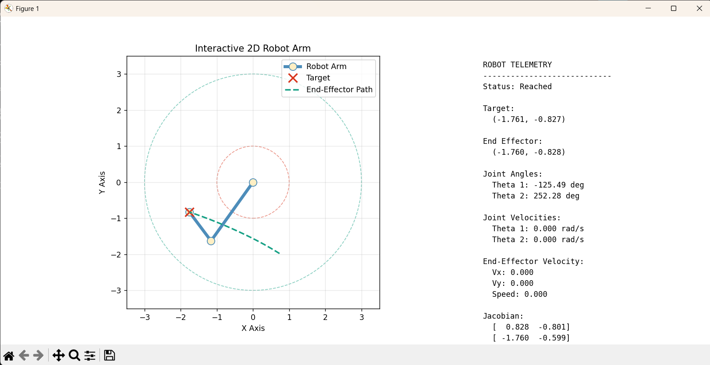
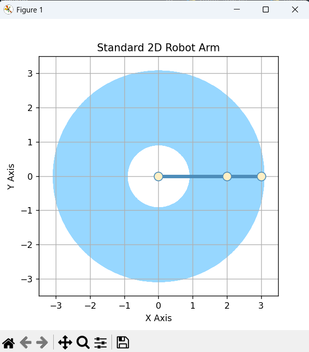
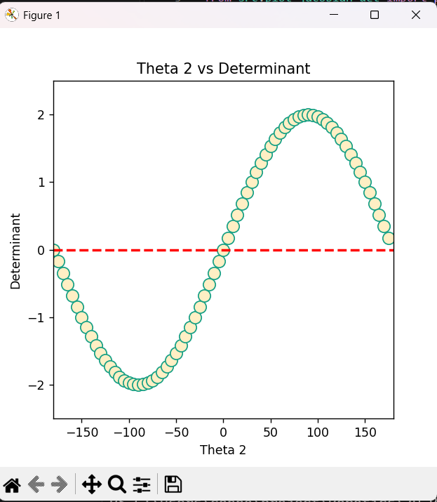
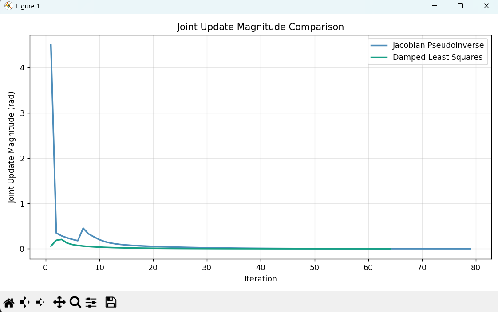

# Interactive 2D Robot Arm Simulator

A Python-based robotics simulator featuring **forward and inverse kinematics, Jacobian-based motion control, singularity analysis, and Damped Least Squares (DLS)**.

Built using **Python, NumPy, and Matplotlib**, this project explores the mathematical foundations of robotic manipulators and applies them to an interactive two-link robot arm.

The main feature is an **interactive click-to-move controller**: users can select a target directly on the workspace, watch the robot move toward it, and monitor joint angles, velocities, Jacobian matrices, and position errors in real time.

## Demo



The interactive simulator supports:

- **Click-to-move:** Select a target position with the mouse.
- **Workspace validation:** Reject unreachable targets without moving the robot.
- **Animated inverse kinematics:** Move toward targets using Damped Least Squares.
- **Live telemetry:** Display joint angles, velocities, positions, Jacobian matrices, and tracking error.
- **End-effector trajectory:** Visualize the path taken toward the target.
- **Multiple target selection:** Move between targets without restarting the simulator.

### Video Demonstration

[Watch the Interactive Robot Demo](docs/videos/interactive_robot.mp4)

The video demonstrates selecting reachable and unreachable targets, robot motion, and the live telemetry dashboard.

## Features and Implementation

### 1. Forward Kinematics

The simulator models a planar robot arm with two revolute joints.

Given joint angles \(\theta_1\) and \(\theta_2\), the end-effector position is:

\[
x=L_1\cos(\theta_1)+L_2\cos(\theta_1+\theta_2)
\]

\[
y=L_1\sin(\theta_1)+L_2\sin(\theta_1+\theta_2)
\]

Forward kinematics is implemented using both direct trigonometric equations and homogeneous transformation matrices.

### 2. Workspace Visualization and Reachability



The reachable workspace of a two-link manipulator forms an annulus:

\[
|L_1-L_2|\leq\sqrt{x^2+y^2}\leq L_1+L_2
\]

For the default robot:

- Link 1 length: 2 units
- Link 2 length: 1 unit
- Minimum reach: 1 unit
- Maximum reach: 3 units

The blue region represents the reachable workspace, while the center region is unreachable.

The simulator checks reachability before attempting inverse kinematics.

### 3. Analytical Inverse Kinematics

Analytical inverse kinematics calculates joint angles for a specified end-effector position.

Using the law of cosines:

\[
\cos(\theta_2)=\frac{x^2+y^2-L_1^2-L_2^2}{2L_1L_2}
\]

For reachable interior targets, the solver can calculate two configurations:

- Elbow-up
- Elbow-down

The calculated joint angles are validated using forward kinematics.

### 4. Jacobian and Differential Kinematics

The Jacobian relates joint velocities to end-effector velocities:

\[
\dot{\mathbf{x}}=J(\boldsymbol{\theta})\dot{\boldsymbol{\theta}}
\]

For the two-link planar arm:

\[
J=
\begin{bmatrix}
-L_1\sin\theta_1-L_2\sin(\theta_1+\theta_2)&-L_2\sin(\theta_1+\theta_2)\\
L_1\cos\theta_1+L_2\cos(\theta_1+\theta_2)&L_2\cos(\theta_1+\theta_2)
\end{bmatrix}
\]

The implementation includes:

- Analytical Jacobian computation
- End-effector velocity calculation
- Numerical validation using finite differences
- Visualization of end-effector velocity vectors

### 5. Singularity Analysis



A singularity occurs when the Jacobian loses rank, limiting the instantaneous directions in which the end effector can move.

For this manipulator:

\[
\det(J)=L_1L_2\sin(\theta_2)
\]

Singular configurations occur when:

\[
\theta_2=k\pi
\]

These configurations correspond to the links being collinear, either fully extended or folded.

The project includes singularity detection and visualization of the Jacobian determinant as a function of the second joint angle.

### 6. Numerical Inverse Kinematics

The project implements iterative inverse kinematics using the Moore–Penrose pseudoinverse.

At each iteration, the Cartesian position error is:

\[
\mathbf e=\mathbf x_{\text{target}}-\mathbf x_{\text{current}}
\]

The joint-angle update is:

\[
\Delta\boldsymbol{\theta}=\alpha J^+\mathbf e
\]

where \(\alpha\) is the step size.

This method iteratively adjusts joint angles until the end effector reaches the target within a specified tolerance.

### 7. Damped Least Squares Inverse Kinematics

The pseudoinverse method can produce excessively large joint updates near singularities.

To improve numerical stability, the project implements Damped Least Squares:

\[
\Delta\boldsymbol{\theta}
=
\alpha J^T(JJ^T+\lambda^2I)^{-1}\mathbf e
\]

The damping coefficient \(\lambda\) reduces sensitivity to small Jacobian singular values, trading some tracking responsiveness for smaller joint updates.

### Experimental Comparison



The two algorithms were evaluated near a singular configuration.

**Experiment setup:**

| Parameter | Value |
|---|---|
| Link lengths | \(L_1=2,\ L_2=1\) |
| Initial joint angles | \(\theta_1=0^\circ,\theta_2=1^\circ\) |
| Target position | (2.5, 0.5) |
| Step size | 0.1 |
| Convergence tolerance | 0.001 |

**Results:**

| Method | Damping | Converged | Iterations |
|---|---|---|---|
| Jacobian Pseudoinverse | N/A | Yes | 79 |
| DLS | 0.05 | Yes | 63 |
| DLS | 0.50 | Yes | 121 |

**Key observations:**

- The pseudoinverse produced an initial joint update of approximately 4.5 radians near the singularity.
- DLS substantially reduced the magnitude of joint updates.
- With damping 0.05, DLS converged in fewer iterations than the pseudoinverse in this experiment.
- Increasing damping to 0.50 resulted in smaller updates but required more iterations.

These results illustrate the tradeoff between numerical stability and convergence speed.

### 8. Interactive Click-to-Move Controller

The interactive controller integrates the kinematics and DLS solver into a single visualization.

**Workflow:**

1. The user clicks a target in the workspace.
2. The simulator checks whether the target is reachable.
3. If unreachable, the simulator prints an error and does not move the robot.
4. If reachable, the DLS solver computes a sequence of joint configurations.
5. Matplotlib animates the robot through the computed configurations.
6. The telemetry panel updates during movement.

**Live telemetry includes:**

| Measurement | Description |
|---|---|
| Target position | Desired Cartesian position |
| End-effector position | Current Cartesian position |
| Joint angles | Joint 1 and Joint 2, in degrees |
| Joint velocities | Estimated angular velocities, in rad/s |
| End-effector velocity | Cartesian velocity computed using the Jacobian |
| Jacobian | Current 2×2 Jacobian matrix |
| Jacobian determinant | Indicator of singular configurations |
| Position error | Distance between current and target positions |
| Solver status | Moving, Reached, Unreachable, or Failed |

Joint and end-effector velocities are estimates based on the simulation time step, rather than physical sensor measurements.

## Installation

### Requirements

- Python 3.10+
- NumPy
- Matplotlib
- pytest

### Setup

Clone the repository:

```bash
git clone https://github.com/YOUR_USERNAME/2D_Robot_Arm.git
cd 2D_Robot_Arm
```

Create and activate a virtual environment:

```bash
python -m venv .venv
```

On Windows:

```powershell
.venv\Scripts\Activate.ps1
```

On Linux/macOS:

```bash
source .venv/bin/activate
```

Install dependencies:

```bash
pip install numpy matplotlib pytest
```

## Usage

### Run the Interactive Simulator

```bash
python -m src.interactive_robot
```

**Controls:**

- Left-click a reachable target to move the robot.
- Click an unreachable point to display an error message.
- Click another target to move from the current configuration.
- Close the Matplotlib window to exit.

### Run the DLS Comparison

```bash
python -m src.demo_dls
```

This compares joint-update magnitudes for the Jacobian pseudoinverse and Damped Least Squares methods.

### Run Automated Tests

```bash
python -m pytest tests/ -v
```

Tests cover forward kinematics, analytical inverse kinematics, Jacobian calculations, numerical validation, singularity detection, and numerical inverse kinematics.

## Technologies Used

| Technology | Purpose |
|---|---|
| Python | Simulation and control logic |
| NumPy | Linear algebra, transformations, and numerical IK |
| Matplotlib | Visualization, animation, and mouse interaction |
| pytest | Automated unit testing |

## Key Learnings

This project provided hands-on experience with:

- Forward and analytical inverse kinematics
- Rotation matrices and homogeneous transformations
- Robot workspace and reachability analysis
- Jacobian matrices and differential kinematics
- Numerical Jacobian validation
- Singularities and numerical instability
- Jacobian pseudoinverse inverse kinematics
- Damped Least Squares and parameter tuning
- Interactive robot control and visualization

## Future Improvements

- Joint-angle and joint-velocity limits
- Collision detection and obstacle avoidance
- Adaptive damping near singularities
- Cartesian trajectory planning and tracking
- Interactive tuning of step size and damping
- Comparison of different inverse-kinematics algorithms
- Extension to higher-degree-of-freedom manipulators

## License

Add a license file to specify the terms under which this project may be used or modified.